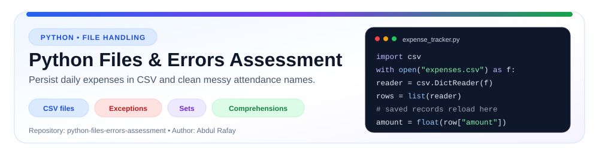
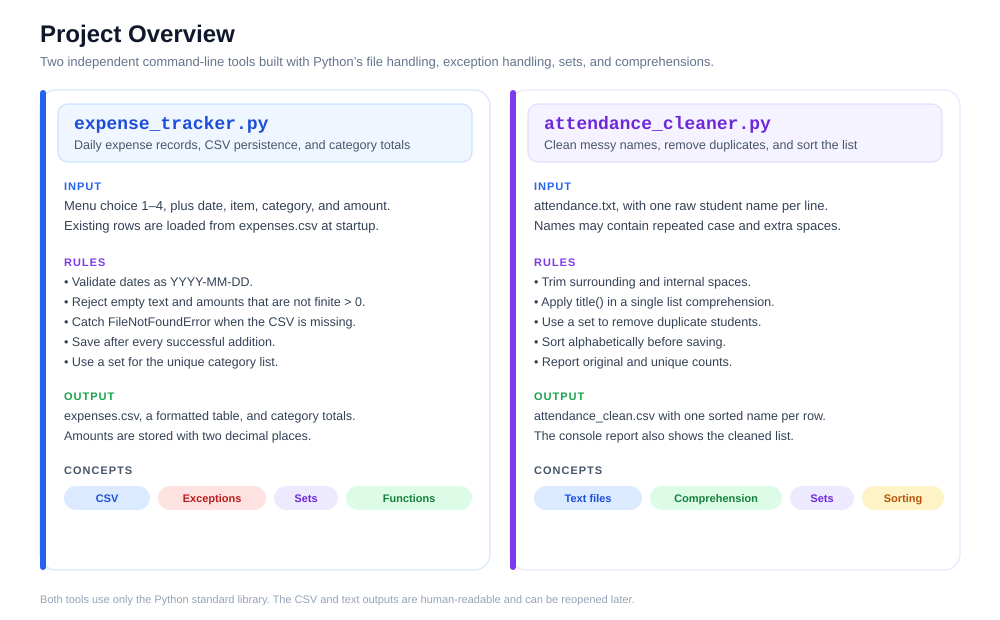
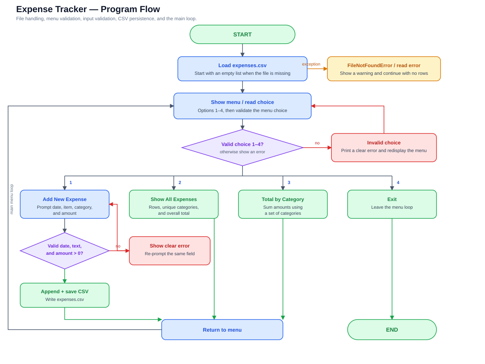
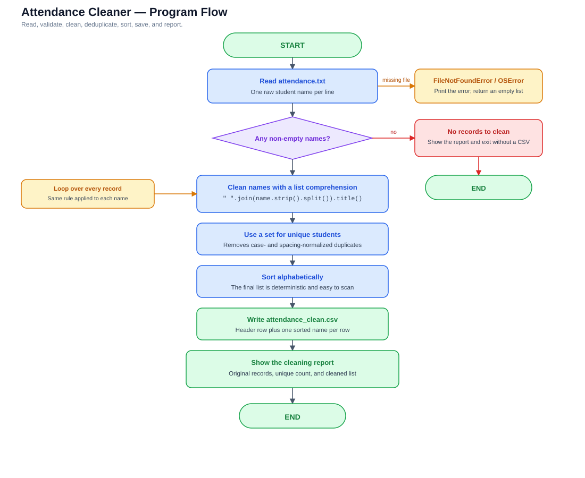
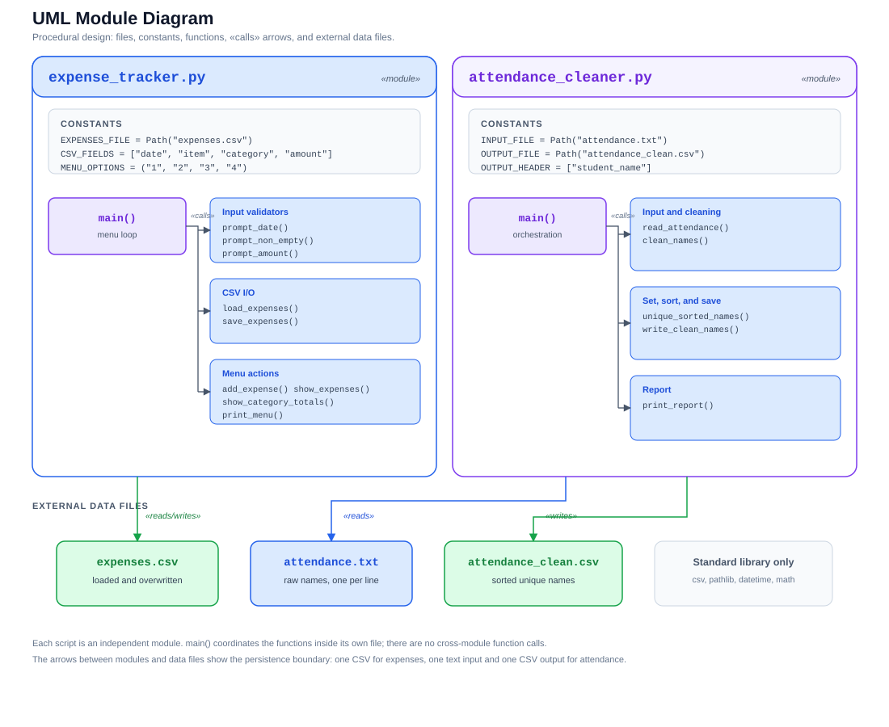

<p align="center"></p>

# Python Files and Errors Assessment

Two command-line tools for a training institute: an expense tracker that stores daily costs in CSV, and an attendance cleaner that normalizes names, removes duplicates, and writes a sorted list.

## 1. Project Overview

| Task | File | Topic |
| --- | --- | --- |
| Institute Expense Tracker | `expense_tracker.py` | File handling, exceptions, sets, menu input |
| Student Attendance Cleaner | `attendance_cleaner.py` | File handling, list comprehensions, sets, sorting |

<p align="center"></p>

## 2. Folder Structure

```text
python-files-errors-assessment/
├── attendance.txt
├── attendance_clean.csv
├── attendance_cleaner.py
├── expense_tracker.py
├── expenses.csv
├── README.md
└── assets/
    ├── banner.svg
    ├── overview.svg
    ├── expense_tracker_flow.svg
    ├── attendance_cleaner_flow.svg
    └── uml_diagram.svg
```

`assets/` holds diagrams for this README. It is extra to the brief and does not change how the programs run. `expenses.csv` and `attendance_clean.csv` are created or updated when the programs run.

## 3. Task 1 — Institute Expense Tracker

### Summary

`expense_tracker.py` is a menu-driven program. On start it loads `expenses.csv` (columns `date,item,category,amount`). If that file is missing, it catches `FileNotFoundError` and begins with an empty list. New expenses are written back to the same CSV so the next run sees them.

### Rules

- Menu options: 1 Add, 2 Show all, 3 Totals by category, 4 Exit.
- Date must be a real calendar date in `YYYY-MM-DD`.
- Item and category cannot be empty.
- Amount must be a finite number greater than zero (`ValueError` is caught and the prompt repeats).
- Unique categories are shown with a **set**.
- A successful add saves the full list to `expenses.csv`.

### Program Flow

<p align="center"></p>

### Code Methods Description

| Method | Purpose |
| --- | --- |
| `prompt_non_empty` | Repeat until the user enters non-blank text. |
| `prompt_date` | Parse `YYYY-MM-DD` with `datetime.strptime`. |
| `prompt_amount` | Convert to `float`, reject non-numeric, non-finite, and non-positive values. |
| `load_expenses` | Read the CSV; on `FileNotFoundError` start empty. |
| `save_expenses` | Overwrite `expenses.csv` with the current rows. |
| `add_expense` | Collect one row and save it immediately. |
| `show_expenses` | Print the table, unique categories (set), and overall total. |
| `show_category_totals` | Sum amounts per category using a set of category names. |
| `print_menu` / `main` | Display options 1–4 and loop until Exit. |

### Input Validation

- Invalid menu choice: error message, menu shown again.
- Invalid date: `ValueError` from `strptime`, prompt again.
- Empty item or category: prompt again.
- Amount `abc`, negative, or zero: `ValueError`, prompt again.

### Expected Results

- Missing CSV: info message, empty list, menu still works.
- Valid add: confirmation, file updated, later run shows the same row.
- Show / totals: table and category sums for all saved rows.

### Errors handled (why)

| Error | Where | Why |
| --- | --- | --- |
| `FileNotFoundError` | `load_expenses` | First run should not crash; start with no rows. |
| `ValueError` | `prompt_amount`, `prompt_date` | Bad amount or date should be re-entered, not abort the session. |
| `OSError` / `csv.Error` | load and save | Unreadable or unwritable files get a message instead of a traceback. |
| `KeyboardInterrupt` | program entry | Ctrl+C stops cleanly. |

### Sets in this task

Unique categories are built with `{expense["category"] for expense in expenses}` and with `set(totals)` when printing category totals.

## 4. Task 2 — Student Attendance Cleaner

### Summary

`attendance_cleaner.py` reads `attendance.txt` (one name per line), cleans spacing and capitalization, drops duplicates with a set, sorts the names, writes `attendance_clean.csv`, and prints a report.

### Rules

- Read one name per line from `attendance.txt`.
- Clean with `strip()` and `title()` inside a **list comprehension**.
- Use a **set** for unique students and report the unique count.
- Sort cleaned names alphabetically.
- Save the final list to `attendance_clean.csv`.
- Display original record count, unique count, and the cleaned list.

### Program Flow

<p align="center"></p>

### Code Methods Description

| Method | Purpose |
| --- | --- |
| `read_attendance` | Load raw lines; catch `FileNotFoundError`. |
| `clean_names` | List comprehension: trim spaces, collapse inner spaces, `title()`. |
| `unique_sorted_names` | `sorted(set(cleaned_names))`. |
| `write_clean_names` | Write CSV header `student_name` plus one name per row. |
| `print_report` | Original count, unique count, and numbered list. |
| `main` | Run the pipeline and return an exit code. |

### Input Validation

- Missing `attendance.txt`: error, empty report, no CSV write.
- Blank lines: ignored (`if name.strip()`).
- Duplicate names that differ only by case or extra spaces: counted as one student after cleaning.

### Expected Results

- Sample file: 12 original records, 8 unique students, sorted CSV.
- Missing file: error message and no output file.

### Errors handled (why)

| Error | Where | Why |
| --- | --- | --- |
| `FileNotFoundError` | `read_attendance` | A missing source file should not crash; the user is told to add names. |
| `OSError` | read and write | Disk or permission problems are reported instead of a traceback. |

### Sets and list comprehensions in this task

```python
cleaned = [" ".join(name.strip().split()).title()
           for name in raw_names if name.strip()]
unique = sorted(set(cleaned))
```

The comprehension normalizes every non-empty line. The set removes duplicates after that normalization.

## 5. UML Diagram

This is a **module diagram** (not a class diagram) because both programs are procedural: files, constants, functions, and `«calls»` arrows, with no classes.

<p align="center"></p>

## 6. Concepts and Techniques Used

- CSV read/write with `csv.DictReader` / `csv.DictWriter` / `csv.writer`
- Text-file input with `pathlib.Path`
- `try` / `except` for `FileNotFoundError`, `ValueError`, and `OSError`
- Sets for unique categories and unique student names
- List comprehensions for name cleaning
- Menu loop and input validation
- Sorting (`sorted`)
- Constants for file names, CSV columns, and menu options

## 7. How to Run

**Requirements:** Python 3.10 or later. No third-party packages.

```bash
git clone https://github.com/abdulraffay54/python-files-errors-assessment.git
cd python-files-errors-assessment
```

Expense tracker:

```bash
python expense_tracker.py
```

Attendance cleaner (uses `attendance.txt` in the same folder):

```bash
python attendance_cleaner.py
```

Alternative launchers:

```bash
python3 expense_tracker.py
python3 attendance_cleaner.py
py expense_tracker.py
py attendance_cleaner.py
```

## 8. Sample Execution

### Expense tracker — invalid input, then a saved row

```text
Welcome to the Institute Expense Tracker

Institute Expense Tracker
===========================
1. Add New Expense
2. Show All Expenses
3. Calculate Total Expenses by Category
4. Exit
Select an option (1-4): 9
Error: '9' is not a valid menu option. Enter 1, 2, 3, or 4.

Select an option (1-4): 1

Add New Expense
----------------
Date (YYYY-MM-DD): 15-11-2026
Error: enter a real date using YYYY-MM-DD. Please try again.
Date (YYYY-MM-DD): 2026-11-15
Item name:
Error: this field cannot be empty. Please try again.
Item name: Notebooks
Category: Stationery
Amount: abc
Error: 'abc' is not a valid amount. Enter a number greater than zero. Please try again.
Amount: -10
Error: '-10' is not a valid amount. Enter a number greater than zero. Please try again.
Amount: 12.5
Saved 6 expense(s) to expenses.csv.
Added: 2026-11-15 | Notebooks | Stationery | 12.50
```

### Expense tracker — data loaded again on the next run

A second start, then option `2`, showed the same six rows, including the new Notebooks line:

```text
Welcome to the Institute Expense Tracker

All Expenses
------------
  #  Date        Item                      Category             Amount
--------------------------------------------------------------------
  1  2026-10-01  Printer paper             Stationery            48.50
  2  2026-10-02  Fiber internet            Internet              75.00
  3  2026-10-05  Tea and biscuits          Refreshments          30.25
  4  2026-10-08  Minibus fuel              Transport             55.00
  5  2026-11-10  Whiteboard markers        Stationery            18.75
  6  2026-11-15  Notebooks                 Stationery            12.50

Unique categories (4): Internet, Refreshments, Stationery, Transport
Total of all expenses: 240.00
```

Category totals from option `3` in the same session:

```text
Internet                  75.00
Refreshments              30.25
Stationery                79.75
Transport                 55.00
All categories           240.00
```

Missing-file start (CSV temporarily removed):

```text
Info: expenses.csv was not found. Starting with an empty expense list.
No expenses have been recorded yet.
```

### Attendance cleaner — duplicates and mixed case

Input `attendance.txt` includes repeats such as `alice   johnson`, `alice Johnson`, and `BOB smith` / `bob Smith`.

```text
Attendance Cleaning Report
===========================
Original records: 12
Cleaned records:  12
Unique students:  8
Duplicate entries removed: 4

Cleaned and sorted attendance list:
   1. Alice Johnson
   2. Bob Smith
   3. Charlie Brown
   4. David Miller
   5. Emma Wilson
   6. Frank De Luca
   7. Grace Lee
   8. Hannah Khan
Saved 8 cleaned name(s) to attendance_clean.csv.
```

Missing `attendance.txt`:

```text
Error: _missing_attendance.txt was not found. No attendance records were processed.
  (no student names found)
```

## 9. Test Cases

### Expense tracker

| # | Scenario | Inputs | Expected result |
| --- | --- | --- | --- |
| 1 | Invalid menu | `9` | Error: not a valid menu option; menu repeats |
| 2 | Invalid date only | `15-11-2026` | Date prompt repeats |
| 3 | Empty item only | blank item | Item prompt repeats |
| 4 | Invalid amount only | `abc` | Amount prompt repeats |
| 5 | Negative amount | `-10` | Amount prompt repeats |
| 6 | Several failures then success | bad date, empty item, `abc`, `-10`, then valid row | Row saved; `expenses.csv` has 6 lines of data |
| 7 | Show all after add | menu `2` | Six rows, four unique categories, total `240.00` |
| 8 | Totals by category | menu `3` | Stationery `79.75`; grand total `240.00` |
| 9 | Reload after restart | menu `2` on a new run | Notebooks `12.50` still present |
| 10 | Missing CSV | no `expenses.csv` | `FileNotFoundError` caught; empty list |
| 11 | Empty list display | menu `2` and `3` with no file | “No expenses have been recorded yet.” |

### Attendance cleaner

| # | Scenario | Inputs | Expected result |
| --- | --- | --- | --- |
| 1 | Success with duplicates | `attendance.txt` (12 messy names) | 8 unique sorted names; CSV written |
| 2 | Duplicate names | `alice johnson` variants | One `Alice Johnson` |
| 3 | Inconsistent case | `BOB smith` / `bob Smith` | One `Bob Smith` |
| 4 | Extra spaces | `  DAVID   miller` | `David Miller` |
| 5 | Missing file | absent text file | `FileNotFoundError` message; no CSV |

---

**Author:** [Abdul Rafay](https://github.com/abdulraffay54)
